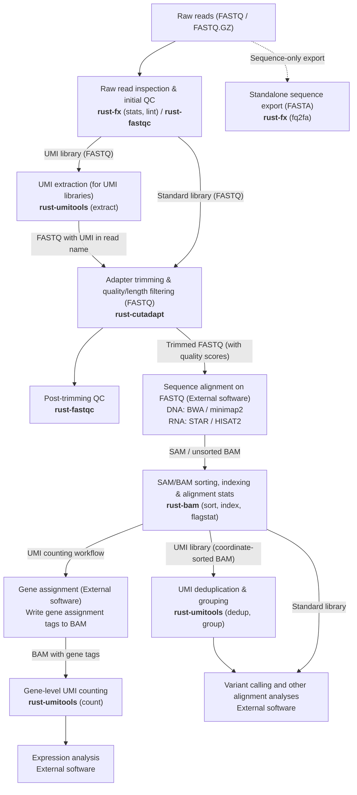

# bioinfo-tools

English | [简体中文](README.zh-CN.md)

## Overview

`bioinfo-tools` is a Rust monorepo containing five command-line tools and two shared libraries for sequencing data preprocessing, sequence file manipulation, quality control, and alignment file processing. Reference software packages at fixed versions are used during development to compare command behavior and outputs.

### Command-Line Tools

- **`rust-cutadapt`** (reference: cutadapt 4.6): Adapter removal, quality and length filtering, paired-end read processing, and sample demultiplexing.
- **`rust-umitools`** (reference: UMI-tools 1.1.6): UMI extraction, barcode whitelist generation, and alignment deduplication, grouping, and counting.
- **`rust-bam`** (reference: samtools 1.24): SAM/BAM format conversion, coordinate sorting, indexing, and `flagstat`, `idxstats`, `quickcheck`, `depth`, `coverage`, `flags`, and `head`.
- **`rust-fastqc`** (reference: FastQC 0.13.0): Implements 12 analysis modules with configurable thresholds, adapters, and contaminant lists; outputs `fastqc_data.txt`, `summary.txt`, HTML, and ZIP archives. The HTML report currently displays data tables; plots are in development.
- **`rust-fx`** (reference: SeqKit 2.14.0, fq 0.12.0): FASTA/FASTQ statistics, format conversion, filtering, sequence transformation, and validation through SeqKit- and fq-style subcommands.

### Shared Libraries

- **`bioinfo-fastx`**: Shared FASTA/FASTQ parsing, reading, writing, and compression handling.
- **`bioinfo-common`**: Shared diagnostics, exit codes, and build information.

See [compat/README.md](compat/README.md) for command-by-command support status and [HISTORY.md](HISTORY.md) for project history.

## Sequencing Workflows

The workflow below uses these formats and molecular tags:

- **FASTQ**: Reads with a quality score for each base, used for preprocessing and alignment.
- **FASTA**: Sequences without quality scores, used for references and sequence exports.
- **UMI (Unique Molecular Identifier)**: A short sequence tag added before amplification. Deduplication uses UMIs and alignment positions to identify PCR duplicates.
- **SAM/BAM**: Stores read alignments against a reference genome in text (SAM) or compressed binary (BAM) format.



### Workflow Steps

1. **Raw Read Inspection and Initial QC**: `rust-fx lint` checks FASTQ syntax and read record integrity, `rust-fx stats` summarizes read counts and lengths, and `rust-fastqc` evaluates per-base quality, GC content, sequence duplication, and adapter content. When sequences are needed without quality scores for external tasks, `rust-fx fq2fa` exports FASTQ records to FASTA as a separate step.
2. **UMI Extraction**: For UMI libraries, `rust-umitools extract` extracts the UMI bases according to the library pattern (for example, moving an 8-bp 5' UMI from the read sequence into the read name). When a barcode whitelist is required prior to extraction, `rust-umitools whitelist` derives it from the raw reads.
3. **Adapter Trimming and Filtering**: `rust-cutadapt` trims adapter sequences and low-quality ends and filters out reads shorter than the specified threshold, outputting trimmed FASTQ files with quality scores preserved.
4. **Post-Trimming QC**: `rust-fastqc` runs on the trimmed FASTQ files to verify adapter removal and read quality distribution.
5. **Alignment (External Software)**: External aligners such as BWA or minimap2 (for DNA data) or STAR or HISAT2 (for RNA data) map the trimmed FASTQ reads to a reference genome. In UMI workflows, the aligner preserves the read names containing the extracted UMIs.
6. **SAM/BAM Processing and UMI Deduplication**: `rust-bam` sorts alignments by coordinate (`sort`), builds indexes (`index`), and inspects alignments (`flagstat`, `idxstats`, `quickcheck`, `depth`, `coverage`). For UMI libraries, `rust-umitools dedup` selects representative reads using alignment positions and UMIs; `group` assigns reads to UMI groups. Both use coordinate-sorted BAM.
7. **Gene Assignment and Further Analysis**: For gene-level UMI counting, an external gene assignment tool first annotates the BAM alignments with gene tags, after which `rust-umitools count` tabulates UMI counts per gene. Variant calling and differential expression analysis follow as downstream steps according to the experimental design.

See [examples/umi-workflow/README.md](examples/umi-workflow/README.md) for a runnable UMI workflow example. That directory includes a synthetic demo with pre-generated SAM/BAM files and also supports execution with external aligners.

## Installation and Usage

### Build from Source

Building from source requires a C compiler toolchain and Rust `1.91` or newer (`rust-toolchain.toml` pins `1.99.1` for repository development). Build using the repository's `Cargo.lock`:

```bash
git clone https://github.com/seek-hope/bioinfo-tools.git
cd bioinfo-tools
cargo build --release --workspace --bins --locked
export PATH="$PWD/target/release:$PATH"
```

### Prebuilt Binaries

Prebuilt binary distributions currently include `rust-cutadapt` and `rust-umitools`. See [dist/README.md](dist/README.md) and [seek-hope/bioinfo-tools-dist](https://github.com/seek-hope/bioinfo-tools-dist) for installation details. The remaining CLIs are built from source.

### Usage Examples

#### Sequence Statistics, Validation, and FASTA Export (`rust-fx`)

```bash
rust-fx stats -a -T reads.fastq.gz
rust-fx lint reads.fastq.gz
rust-fx fq2fa -w 0 reads.fastq.gz -o reads.fasta
```

#### Adapter Trimming and Post-Trimming QC (`rust-cutadapt`, `rust-fastqc`)

Set the adapter sequence and length threshold according to your library design:

```bash
rust-cutadapt -a AGATCGGAAGAGC -m 30 -j 4 \
  -o trimmed.fastq.gz reads.fastq.gz
mkdir -p qc
rust-fastqc --extract -o qc trimmed.fastq.gz
```

#### UMI Extraction and Adapter Trimming (`rust-umitools`, `rust-cutadapt`)

This example moves the first 8 bases of each read into the read name as the UMI and then trims adapters (adjust the UMI pattern and adapter sequence for your library):

```bash
rust-umitools extract -p NNNNNNNN -I reads.fastq.gz -S umi.fastq.gz
rust-cutadapt -a AGATCGGAAGAGC -m 30 -j 4 \
  -o umi.trimmed.fastq.gz umi.fastq.gz
```

#### BAM Sorting, Indexing, and UMI Deduplication (`rust-bam`, `rust-umitools`)

After aligning `umi.trimmed.fastq.gz` into `aligned.bam` with an external aligner that preserves read names, sort, index, check alignment statistics, and deduplicate:

```bash
rust-bam sort -o sorted.bam aligned.bam
rust-bam index sorted.bam
rust-bam flagstat sorted.bam
rust-umitools dedup --random-seed 1 --compresslevel 6 \
  -I sorted.bam -S dedup.bam
```

This `dedup` command reads UMIs from the read name. For BAM files where the UMI is stored in the `UB` tag, pass `--extract-umi-method=tag --umi-tag=UB`.

### Development Checks

Run the repository verification scripts:

```bash
bash tests/ci/check.sh
bash tests/ci/check.sh --with-fastx-qc-oracles
```

The second command runs checks against locally installed, pinned versions of the reference tools. See [tests/ci/README.md](tests/ci/README.md) for details.

## Performance Comparison with Reference Software

Measured on 2026-11-01 (UTC) on an i7-13700H laptop with 31.1 GiB RAM and NVMe storage.
The table shows the median [minimum–maximum] of three runs after a warm-up.
Ratios are the median of the paired reference/current times; values above 1
mean the current implementation is faster.

Inputs repeat fixed one-million-record populations: real 150 bp reads from
SRR2584863, synthetic 150 bp FASTQ, and synthetic 50 bp BAM. M denotes million
records. Repetition increases processing work while retaining the source
sequence diversity. The same input is used for each core budget.

<!-- README_SCALE_START -->
| Operation | Input | CPU Budget | Reference Time (s) | Current Implementation Time (s) | Reference / Current |
| --- | --- | ---: | ---: | ---: | ---: |
| cutadapt plain | Real FASTQ, 54M | 1 | 127.21 [120.21–141.27] | 145.22 [142.22–157.21] | 0.89× |
| cutadapt plain | Real FASTQ, 54M | 2 | 99.02 [95.21–108.38] | 147.06 [143.26–175.30] | 0.66× |
| cutadapt plain | Real FASTQ, 54M | 4 | 106.41 [78.99–106.69] | 138.99 [113.83–156.92] | 0.69× |
| cutadapt plain | Synthetic FASTQ, 46M | 1 | 125.39 [113.53–132.81] | 112.06 [94.95–119.51] | 1.05× |
| cutadapt plain | Synthetic FASTQ, 46M | 2 | 84.83 [66.85–92.55] | 121.61 [105.32–149.98] | 0.63× |
| cutadapt plain | Synthetic FASTQ, 46M | 4 | 65.63 [61.38–72.03] | 72.77 [65.97–130.40] | 0.84× |
| cutadapt gzip6 output | Real FASTQ, 8M | 1 | 65.34 [65.16–65.40] | 58.41 [58.32–58.62] | 1.12× |
| cutadapt gzip6 output | Real FASTQ, 8M | 2 | 53.84 [53.60–53.85] | 29.47 [29.38–29.53] | 1.83× |
| cutadapt gzip6 output | Real FASTQ, 8M | 4 | 21.63 [21.52–21.75] | 16.83 [16.76–16.87] | 1.28× |
| SeqKit stats -a -T | Real FASTQ, 30M | 1 | 15.61 [15.51–15.69] | 15.47 [15.47–15.54] | 1.00× |
| SeqKit stats -a -T | Real FASTQ, 30M | 2 | 15.36 [15.21–15.37] | 15.68 [15.55–15.68] | 0.98× |
| SeqKit stats -a -T | Real FASTQ, 30M | 4 | 15.37 [15.36–15.44] | 15.92 [15.92–15.99] | 0.96× |
| SeqKit stats -a -T | Synthetic FASTQ, 41M | 1 | 16.13 [15.91–16.15] | 21.21 [21.18–21.22] | 0.76× |
| SeqKit stats -a -T | Synthetic FASTQ, 41M | 2 | 15.99 [15.72–16.11] | 21.47 [21.37–21.58] | 0.74× |
| SeqKit stats -a -T | Synthetic FASTQ, 41M | 4 | 15.85 [15.82–16.15] | 21.93 [21.86–22.44] | 0.72× |
| SeqKit fq2fa | Synthetic FASTQ, 146M | 1 | 155.21 [138.19–179.92] | 134.25 [119.64–138.81] | 1.16× |
| SeqKit fq2fa | Synthetic FASTQ, 146M | 4 | 106.11 [103.83–132.82] | 135.81 [110.02–139.59] | 0.95× |
| fq lint | Synthetic FASTQ, 102M | 1 | 28.35 [26.81–29.14] | 23.06 [22.60–23.28] | 1.23× |
| fq lint | Synthetic FASTQ, 102M | 4 | 29.53 [29.41–30.40] | 27.34 [25.07–27.74] | 1.11× |
| samtools flagstat | Synthetic BAM, 755M | 1 | 34.51 [28.53–34.66] | 69.57 [65.09–76.03] | 0.45× |
| samtools flagstat | Synthetic BAM, 755M | 4 | 16.38 [16.35–16.43] | 60.60 [60.33–61.01] | 0.27× |
| samtools sort | Synthetic BAM, 86M | 1 | 43.66 [42.45–44.77] | 94.89 [93.55–97.71] | 0.46× |
| samtools sort | Synthetic BAM, 86M | 2 | 52.44 [52.40–52.47] | 91.77 [91.50–91.93] | 0.57× |
| samtools sort | Synthetic BAM, 86M | 4 | 23.18 [23.14–23.18] | 91.61 [91.11–91.68] | 0.25× |
| UMI-tools directional dedup | Synthetic BAM, 71M | 1 | 228.66 [223.20–237.04] | 15.27 [15.26–15.29] | 14.98× |
| UMI-tools directional dedup | Synthetic BAM, 71M | 4 | 215.23 [215.09–216.18] | 14.80 [14.76–14.83] | 14.54× |
<!-- README_SCALE_END -->

Core budgets allocate 1, 2 or 4 physical P cores. Current FX and flagstat
processing are serial; BAM sort workers compress the final BAM output.
The [full results](bench/SCALE.md) include input bytes, commands, CPU usage,
peak RSS, temporary storage and output checks. Timings include startup and
ordinary I/O; post-exit fsync is recorded separately. Plain-output trimming
and conversion showed wide variation and low CPU use. Gzip trimming and lint
were faster in this run; synthetic statistics and the BAM operations remain
optimization priorities. The UMI result applies to the specified synthetic
four-UMI population.

### FastQC Runtime

The implementations differ in GC and duplication statistics and report
graphics, so these timings are listed without a speed ratio. The current
implementation processes one input serially.

| Operation | Input | CPU Budget | Reference Time (s) | Current Implementation Time (s) |
| --- | --- | ---: | ---: | ---: |
| FastQC (descriptive) | Real FASTQ, 9M | 1 | 34.31 [34.29–34.31] | 40.15 [40.13–40.19] |
| FastQC (descriptive) | Real FASTQ, 9M | 4 | 15.09 [15.09–15.11] | 41.24 [41.02–41.45] |

See [bench/README.md](bench/README.md) for the measurement methods.
Earlier measurements remain available in [bench/RESULTS-README.md](bench/RESULTS-README.md)
and [bench/OPTIMIZATION.md](bench/OPTIMIZATION.md).

## Development Roadmap

Near-term priorities:

- Complete subcommand, option, and file format support across the existing tools.
- Finish GC and duplication statistics verification and HTML graphical reports in `rust-fastqc`.
- Continue optimizing runtime hotspots and expand prebuilt binary distributions.

Future directions:

- **BED/GFF Interval Operations**: Genomic interval manipulation and overlap statistics.
- **Feature Counting and Expression Data**: Read-to-feature counting and expression matrix processing.
- **VCF/BCF Processing**: Variant querying, filtering, and summary statistics.

See [docs/DEVELOPMENT-PLAN.md](docs/DEVELOPMENT-PLAN.md) for the full development plan.
