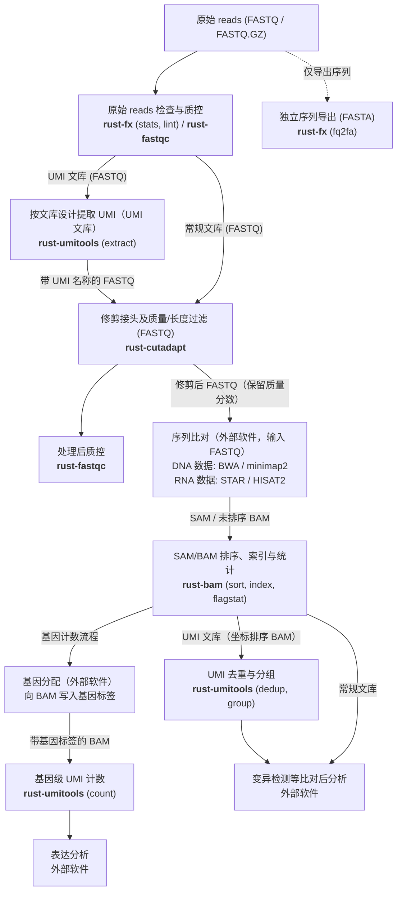

# bioinfo-tools

[English](README.md) | 简体中文

## 仓库内容概述

`bioinfo-tools` 是 用 Rust 编写的生物信息学工具集，包含五个 CLI 和两个共享库。原生程序用于测序数据预处理、序列文件操作、质控及比对结果处理；参考软件用于开发与行为对照。

### 命令行工具

- **`rust-cutadapt`**（参考 cutadapt 4.6）：接头去除、质量/长度过滤、双端 reads 处理、拆分样本。
- **`rust-umitools`**（参考 UMI-tools 1.1.6）：UMI 提取、白名单、去重、分组与计数。
- **`rust-bam`**（参考 samtools 1.24）：SAM/BAM 格式转换、坐标排序、索引、`flagstat`、`idxstats`、`quickcheck`、`depth`、`coverage`、`flags`、`head`。
- **`rust-fastqc`**（参考 FastQC 0.13.0）：提供 12 个分析模块，支持配置阈值、接头、污染物；输出 `fastqc_data.txt`、`summary.txt`、HTML 和 ZIP。当前 HTML 展示数据表，图形报告继续开发。
- **`rust-fx`**（参考 SeqKit 2.14.0、fq 0.12.0）：FASTA/FASTQ 统计、格式转换、筛选、序列变换及校验，提供 SeqKit/fq 风格子命令。

### 共享库

- **`bioinfo-fastx`**：共享 FASTX 解析、读写与压缩。
- **`bioinfo-common`**：共享诊断、退出码与构建信息。

逐命令支持情况见 [compat/README.md](compat/README.md)，项目历史见 [HISTORY.md](HISTORY.md)。

## 测序数据处理流程与各工具作用

测序数据处理涉及的主要文件与标记如下：

- **FASTQ**：包含序列及逐碱基质量分数。修剪和比对通常以 FASTQ 为输入。
- **FASTA**：仅保存序列，不含质量分数，用于参考序列或独立的序列导出场景。
- **UMI**：在扩增前标记原始分子的短随机序列，去重时结合 UMI 和比对位置识别 PCR 扩增产生的重复 reads。
- **SAM/BAM**：保存序列与参考基因组的比对结果（SAM 为文本格式，BAM 为二进制压缩格式）。



### 流程步骤说明

1. **原始 reads 检查与质控**：使用 `rust-fx lint` 校验 FASTQ 格式，`rust-fx stats` 统计序列数量与长度分布，`rust-fastqc` 分析质量分布、GC 含量、重复度及接头残留。当其他分析仅需纯序列文件时，可单独使用 `rust-fx fq2fa` 将 FASTQ 导出为 FASTA。
2. **提取 UMI（UMI 文库）**：使用 `rust-umitools extract` 按文库设计提取 UMI（例如把 read 起始 8 个碱基移到 read 名称中）；若需预先生成 barcode 白名单，可使用 `rust-umitools whitelist`。
3. **修剪接头及过滤**：使用 `rust-cutadapt` 去除接头并按质量或长度过滤，输出保留质量分数的 FASTQ 文件。
4. **处理后质控**：使用 `rust-fastqc` 检查修剪后的 FASTQ，确认接头去除效果与序列质量。
5. **序列比对（外部软件）**：将修剪后的 FASTQ 交给外部比对器处理，例如 DNA 数据常用 BWA 或 minimap2，RNA 数据常用 STAR 或 HISAT2。在 UMI 流程中，比对器需保留包含 UMI 的 read 名称。
6. **SAM/BAM 排序、索引、统计与去重**：使用 `rust-bam` 对结果进行坐标排序（`sort`）、建立索引（`index`）及统计检查（`flagstat`、`idxstats`、`quickcheck`、`depth`、`coverage`）。对于 UMI 文库，使用 `rust-umitools dedup`（或 `group`）对坐标排序后的 BAM 进行去重或分子分组。
7. **基因计数与后续分析**：执行基因级 UMI 计数（`rust-umitools count`）前，需要先由外部基因分配工具将基因标签写入 BAM 记录；变异检测、差异表达分析等属于流程的后续步骤，按具体实验目标继续分析。

可执行示例见 [examples/umi-workflow/README.md](examples/umi-workflow/README.md)。该目录包含预先生成 SAM/BAM 的合成演示，也支持调用外部比对器运行。

## 安装与使用说明

### 源码构建

构建需要 C 编译工具链，Rust 最低版本为 `1.91`（`rust-toolchain.toml` 固定开发工具链为 `1.99.1`）。使用仓库的 `Cargo.lock` 编译：

```bash
git clone https://github.com/seek-hope/bioinfo-tools.git
cd bioinfo-tools
cargo build --release --workspace --bins --locked
export PATH="$PWD/target/release:$PATH"
```

### 预编译二进制

预编译分发当前包含 `rust-cutadapt` 和 `rust-umitools`，安装方法见 [dist/README.md](dist/README.md) 与 [seek-hope/bioinfo-tools-dist](https://github.com/seek-hope/bioinfo-tools-dist)。其余 CLI 通过源码构建。

### 使用示例

#### 序列统计、校验与 FASTA 导出（`rust-fx`）

```bash
rust-fx stats -a -T reads.fastq.gz
rust-fx lint reads.fastq.gz
rust-fx fq2fa -w 0 reads.fastq.gz -o reads.fasta
```

#### 接头修剪与质控（`rust-cutadapt`、`rust-fastqc`）

接头序列和过滤阈值按文库设计填写：

```bash
rust-cutadapt -a AGATCGGAAGAGC -m 30 -j 4 \
  -o trimmed.fastq.gz reads.fastq.gz
mkdir -p qc
rust-fastqc --extract -o qc trimmed.fastq.gz
```

#### UMI 提取与修剪（`rust-umitools`、`rust-cutadapt`）

以下示例把 read 起始 8 个碱基移到名称中，然后修剪接头并过滤短序列（UMI 模式与接头序列按文库设计填写）：

```bash
rust-umitools extract -p NNNNNNNN -I reads.fastq.gz -S umi.fastq.gz
rust-cutadapt -a AGATCGGAAGAGC -m 30 -j 4 \
  -o umi.trimmed.fastq.gz umi.fastq.gz
```

#### BAM 排序、索引与 UMI 去重（`rust-bam`、`rust-umitools`）

用外部比对器把 `umi.trimmed.fastq.gz` 比对为 `aligned.bam`（保留 read 名称），随后排序、建索引、统计并去重：

```bash
rust-bam sort -o sorted.bam aligned.bam
rust-bam index sorted.bam
rust-bam flagstat sorted.bam
rust-umitools dedup --random-seed 1 --compresslevel 6 \
  -I sorted.bam -S dedup.bam
```

这组去重命令默认读取 read 名称中的 UMI。对于 UMI 保存在 `UB` 标签的 BAM，使用 `--extract-umi-method=tag --umi-tag=UB`。

### 开发检查

运行仓库检查脚本：

```bash
bash tests/ci/check.sh
bash tests/ci/check.sh --with-fastx-qc-oracles
```

第二条命令使用本地已安装的固定版本参考软件进行对照检查。细节见 [tests/ci/README.md](tests/ci/README.md)。

## 和参考软件的性能对比

测量于 2026-11-01（UTC），使用 i7-13700H 笔记本、31.1 GiB 内存和 NVMe 存储。
每个条件预热一次，再测量三轮；表中耗时为中位数 [最小值–最大值]。
倍数取逐轮“参考软件耗时 / 当前实现耗时”的中位数，大于 1 表示当前实现更快。

输入由固定的百万条数据重复生成：SRR2584863 的真实 150 bp reads、合成 150 bp FASTQ
和合成 50 bp BAM。M 表示百万条记录。重复增加处理量，序列种类保持不变。
同一工作负载在各核心预算下使用相同输入。

<!-- README_SCALE_START -->
| 操作 | 输入 | CPU 核心预算 | 参考软件耗时（秒） | 当前实现耗时（秒） | 参考软件 / 当前 |
| --- | --- | ---: | ---: | ---: | ---: |
| 接头修剪，FASTQ | 真实 FASTQ, 54M | 1 | 127.21 [120.21–141.27] | 145.22 [142.22–157.21] | 0.89× |
| 接头修剪，FASTQ | 真实 FASTQ, 54M | 2 | 99.02 [95.21–108.38] | 147.06 [143.26–175.30] | 0.66× |
| 接头修剪，FASTQ | 真实 FASTQ, 54M | 4 | 106.41 [78.99–106.69] | 138.99 [113.83–156.92] | 0.69× |
| 接头修剪，FASTQ | 合成 FASTQ, 46M | 1 | 125.39 [113.53–132.81] | 112.06 [94.95–119.51] | 1.05× |
| 接头修剪，FASTQ | 合成 FASTQ, 46M | 2 | 84.83 [66.85–92.55] | 121.61 [105.32–149.98] | 0.63× |
| 接头修剪，FASTQ | 合成 FASTQ, 46M | 4 | 65.63 [61.38–72.03] | 72.77 [65.97–130.40] | 0.84× |
| 接头修剪，gzip 级别 6 | 真实 FASTQ, 8M | 1 | 65.34 [65.16–65.40] | 58.41 [58.32–58.62] | 1.12× |
| 接头修剪，gzip 级别 6 | 真实 FASTQ, 8M | 2 | 53.84 [53.60–53.85] | 29.47 [29.38–29.53] | 1.83× |
| 接头修剪，gzip 级别 6 | 真实 FASTQ, 8M | 4 | 21.63 [21.52–21.75] | 16.83 [16.76–16.87] | 1.28× |
| SeqKit stats -a -T | 真实 FASTQ, 30M | 1 | 15.61 [15.51–15.69] | 15.47 [15.47–15.54] | 1.00× |
| SeqKit stats -a -T | 真实 FASTQ, 30M | 2 | 15.36 [15.21–15.37] | 15.68 [15.55–15.68] | 0.98× |
| SeqKit stats -a -T | 真实 FASTQ, 30M | 4 | 15.37 [15.36–15.44] | 15.92 [15.92–15.99] | 0.96× |
| SeqKit stats -a -T | 合成 FASTQ, 41M | 1 | 16.13 [15.91–16.15] | 21.21 [21.18–21.22] | 0.76× |
| SeqKit stats -a -T | 合成 FASTQ, 41M | 2 | 15.99 [15.72–16.11] | 21.47 [21.37–21.58] | 0.74× |
| SeqKit stats -a -T | 合成 FASTQ, 41M | 4 | 15.85 [15.82–16.15] | 21.93 [21.86–22.44] | 0.72× |
| SeqKit fq2fa | 合成 FASTQ, 146M | 1 | 155.21 [138.19–179.92] | 134.25 [119.64–138.81] | 1.16× |
| SeqKit fq2fa | 合成 FASTQ, 146M | 4 | 106.11 [103.83–132.82] | 135.81 [110.02–139.59] | 0.95× |
| fq lint | 合成 FASTQ, 102M | 1 | 28.35 [26.81–29.14] | 23.06 [22.60–23.28] | 1.23× |
| fq lint | 合成 FASTQ, 102M | 4 | 29.53 [29.41–30.40] | 27.34 [25.07–27.74] | 1.11× |
| samtools flagstat | 合成 BAM, 755M | 1 | 34.51 [28.53–34.66] | 69.57 [65.09–76.03] | 0.45× |
| samtools flagstat | 合成 BAM, 755M | 4 | 16.38 [16.35–16.43] | 60.60 [60.33–61.01] | 0.27× |
| samtools sort | 合成 BAM, 86M | 1 | 43.66 [42.45–44.77] | 94.89 [93.55–97.71] | 0.46× |
| samtools sort | 合成 BAM, 86M | 2 | 52.44 [52.40–52.47] | 91.77 [91.50–91.93] | 0.57× |
| samtools sort | 合成 BAM, 86M | 4 | 23.18 [23.14–23.18] | 91.61 [91.11–91.68] | 0.25× |
| UMI-tools directional dedup | 合成 BAM, 71M | 1 | 228.66 [223.20–237.04] | 15.27 [15.26–15.29] | 14.98× |
| UMI-tools directional dedup | 合成 BAM, 71M | 4 | 215.23 [215.09–216.18] | 14.80 [14.76–14.83] | 14.54× |
<!-- README_SCALE_END -->

核心预算分配 1、2 或 4 个物理 P 核。当前 FX 和 flagstat 串行处理数据，BAM sort
通过工作线程压缩最终 BAM 输出。[完整结果](bench/SCALE.md)还列出输入字节数、命令、
CPU 使用量、峰值 RSS、临时空间和输出校验结果。耗时包含启动与普通 I/O，进程退出后的
fsync 单独记录。未压缩剪切和格式转换的耗时波动较大，CPU 使用量较低。本轮 gzip
剪切和 lint 更快；合成数据统计与 BAM 操作仍是优化重点。UMI 结果对应本次指定的
四种 UMI 合成数据。

### FastQC 耗时

两种实现的 GC、重复度统计和图形资源仍有差异，因此这里只列耗时。
当前实现串行处理单个输入。

| 操作 | 输入 | CPU 核心预算 | 参考软件耗时（秒） | 当前实现耗时（秒） |
| --- | --- | ---: | ---: | ---: |
| 质控报告 | 真实 FASTQ, 9M | 1 | 34.31 [34.29–34.31] | 40.15 [40.13–40.19] |
| 质控报告 | 真实 FASTQ, 9M | 4 | 15.09 [15.09–15.11] | 41.24 [41.02–41.45] |

测试方法见 [bench/README.md](bench/README.md)。历史测量见
[bench/RESULTS-README.md](bench/RESULTS-README.md) 和
[bench/OPTIMIZATION.md](bench/OPTIMIZATION.md)。

## 后续开发路线图

近期重点：

- 完善现有工具的命令、参数和格式支持。
- 完成 `rust-fastqc` 的 GC/重复度统计核对与图形报告。
- 继续优化性能热点并扩展预编译分发。

后续方向：

- **BED/GFF 区间操作**：基因组区间运算与重叠统计。
- **特征计数与表达数据**：特征计数（feature counting）与表达数据处理。
- **VCF/BCF 处理**：变异文件查询、过滤与统计。

详细计划见 [docs/DEVELOPMENT-PLAN.md](docs/DEVELOPMENT-PLAN.md)。
