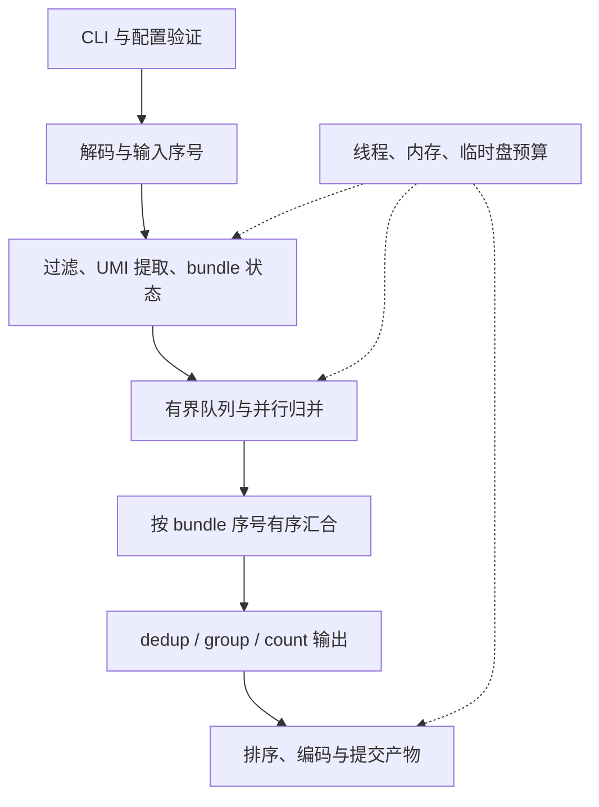

# UMI-tools 的 Rust 高性能版实现方案

> Historical design proposal. BAM/SAM/CRAM I/O was migrated from rust-htslib to noodles on 2026-10-23; see [ADR 0001](adr/0001-noodles-migration.md) and [migration evidence](../../docs/EVIDENCE-NOODLES.md). Statements below about retaining rust-htslib describe the earlier plan.

状态：历史设计提案。起草时的代码基线为 `a35fd81`、包版本为 `0.1.0`；正文中的“当前实现”和阶段安排保留当时语境。后续已实现的能力以 [兼容矩阵](COMPATIBILITY.md) 为准，当前优先级见[根开发计划](../../docs/DEVELOPMENT-PLAN.md)；[ROADMAP.md](ROADMAP.md) 保留后续迭代记录。

项目现已更名为 `rust-umitools`（本方案最初起草时计划保留原名 `rust-umidedup`，随后按用户决定更名），将其发展为覆盖 UMI-tools 常用工作流的 Rust 工具集。先建立可执行的兼容性标准，再扩展命令和优化性能。第一项交付是可靠的单端 `dedup`，而不是在现有单文件实现上直接加入双端分支。

对照基线固定为 **UMI-tools 1.1.6**，源码提交 `3f2cb4f41e07fe4a6cea3b3389f534bee957176b`。升级对照版本必须重新运行差异测试；不得混用不同版本的默认行为。源码依据见文末。[S1]

## 1. 目标、范围与兼容性承诺

### 1.1 产品目标

- 在已验收的参数组合下，保持 UMI-tools 的输入解释、分组、UMI 归并、计数和输出接口语义。
- 利用紧凑编码、精确邻居查询、按独立分组并行及并行压缩降低 CPU 时间与内存占用。
- 支持普通工作站和服务器，提供线程、内存、临时目录预算，并保证相同输入、参数和随机种子下的结果不随工作线程调度改变。
- 保留现有 `rust-umitools in.bam out.bam [threads]` 调用；新增子命令调用，并逐步支持把脚本中的 `umi_tools` 命令替换为 `rust-umitools`。

首期不实现 Python API 的替代品，不更换现有项目名，不引入 GPU、分布式调度或新的生物学归并规则。算法、存储与并行策略可以优化，但凡改变结果语义的选项必须明确标为扩展。

### 1.2 将兼容性拆成可验收的层次

| 层次 | 验收对象 | 判定方式 |
|---|---|---|
| C1：调用兼容 | 命令、参数、默认值、选项组合、输入输出格式 | 参数矩阵；未知/未实现参数在创建输出文件前失败 |
| C2：分组兼容 | 过滤后的 records、bundle、UMI 到分子组的分配、代表 UMI、组计数 | 对照规范化成员集合；不能只比较总分子数 |
| C3：记录兼容 | 代表 read、mate、BAM tags、序列、质量、表格和排序 | 无随机歧义时逐记录一致；指定严格随机策略时验证固定 seed 的结果 |
| C4：文件层面 | header、压缩块、文本格式、字节校验和 | 仅对明确固定的产物格式承诺；不默认要求 BAM 压缩字节相同 |

同样的分子总数、高 Pearson 相关系数或不同工具间接对照，都不能单独证明 C2/C3。不同线程数的 Rust 输出应在规范化记录层面一致；压缩库版本或 header 不同导致的 MD5 差异要单独解释。

未来维护 `docs/compatibility.tsv`：每行包含上游版本、命令、参数组合、默认值、支持状态、fixture ID、比较规则及已知差异。状态限于 `unsupported`、`experimental`、`verified`。支持一个参数不代表它和所有其他参数的组合都已支持。

### 1.3 命令覆盖顺序

| 命令/能力 | 交付顺序 | 主要内容 |
|---|---|---|
| CLI 骨架与单端 `dedup` | 第一阶段 | directional、名称中的 UMI、真实 UMI 长度、正确排序、错误处理、资源预算 |
| 完整 `dedup` 常用途径 | 第二阶段 | 五种方法、距离阈值、tags、双端、multimapping、可选分组维度及统计输出 |
| `group`、`count`、`count_tab` | 第三阶段 | 复用归并核心；分组标签、gene/cell 计数、稀疏聚合 |
| `extract` | 第四阶段 | FASTQ 单/双端、固定模式、质量过滤/掩码、barcode 白名单；随后扩展 regex |
| `whitelist` | 第五阶段 | barcode 频次、distance/density knee、纠错映射、数值与边界验证 |
| SAM/CRAM、流输入输出、发布包 | 随阶段交付 | SAM 先行；CRAM 与流式扩展独立验收，不用“格式可打开”替代完整支持 |

UMI-tools 1.1.6 的 `dedup` 使用 `--stdin` 指定文件，但会拒绝真正的标准输入流；默认输出还会重新排序。[S4] 因此真正的 pipe 输入属于扩展能力，不应误写为既有上游功能的简单复刻。

## 2. 当前实现审查与第一批缺陷

现有实现约 277 行，集中于 [`src/main.rs`](../src/main.rs)。已有价值是 rust-htslib I/O、Rayon 分组并行、短 UMI 邻居枚举及固定种子的代表 read 选择。它适合作为原型，不宜直接作为“完整语义等价”的基线。

### 2.1 已用最小输入复现的问题

下列检查使用当前 release 二进制、1 个线程、临时 SAM 文件输入；输出条数取 stderr，输出顺序从 BAM 解码。没有修改软件源码，也没有重新运行大型性能测试。

| ID | 输入条件 | 当前结果 | 正确性要求 |
|---|---|---|---|
| B01 | 同位置两条 read，UMI 为 `AAAAAAAAA` 和 `CAAAAAAAA`，计数均为 1 | 输出 2 条 | 9 nt UMI 的 Hamming 距离为 1，directional 应得到 1 组；`dedup_bundle` 的 `len = 8` 漏掉首位 |
| B02 | 同位置 UMI 为 `A` 与 `AA` | 输出 1 条 | 编码不能碰撞；1.1.6 会检查同一 bundle 的 UMI 等长，兼容模式应明确拒绝混合长度 [S2] |
| B03 | 一条 mapped read 后接一条 `FLAG=4,RNAME=*,POS=0` 的 unmapped read | exit 3，报告未排序 | 应先区分无坐标记录和有坐标记录，再按过滤策略处理；不能把 `tid=-1` 直接当作倒退 |
| B04 | POS=101、CIGAR=`10M`；随后 POS=102、CIGAR=`5S5M`，两个互不归并的 UMI | 输出原始 POS 顺序为 `102,101` | 修正后位置顺序不等于 BAM 坐标排序；默认排序输出需显式实现 |

B01/B02 的最小 fixture 中，两条 read 均使用 `FLAG=0`、`chr1:101`、`MAPQ=60`、`CIGAR=10M`，read name 为 `r1_<UMI>`、`r2_<UMI>`，序列和质量分别为 10 个 `A`、10 个 `I`。B04 使用同样的序列长度，UMI 分别为 `AAAAAAAA` 与 `CCCCCCCC`。这些 fixture 应进入第一阶段的回归集。

### 2.2 静态核对发现的设计风险

| ID | 现状 | 处理方案 |
|---|---|---|
| B05 | 大小写被合并，所有非 A/C/G/T 字节都编码为同一值；数值序与原始字节词典序不同 | 快速路径保留可逆编码；一般路径保留原字节；禁止静默归一化；代表 UMI 的平局按上游实际排序规则 |
| B06 | `last_start` 每条 read 更新；密集坐标下相邻差始终小于 1000，可能直到换 contig 才释放 | 不声称内存天然只与 1000 bp 窗口有关；记录内存高水位，支持 active bundle 状态溢写；见第 4 节 |
| B07 | Rayon 的 T 个线程之外，reader/writer 各开约 T/2 个 BGZF 线程 | `--threads T` 统一管理计算与 I/O 工作线程；避免实际工作线程接近 2T |
| B08 | `u32` 计数及 `2*count-1` 可能溢出 | 计数用 `u64`、checked add；比较使用 `u128` 中间值 |
| B09 | 创建输出早于完整参数验证，存在 `expect`；未拒绝输入输出同一路径 | 参数先验证；比较规范路径与文件身份；结构化错误；文件输出采用临时产物和成功后提交 |
| B10 | 线程值 `0` 未显式拒绝；多余参数可能被忽略 | 类型化 CLI，验证正整数和参数个数；未知参数一律报错 |
| B11 | 当前只选每个 UMI 的最高 MAPQ 候选，没有完整复现 NH/X0/XT、paired、gene/cell 等路径 | 将过滤、选代表、key 构造和命令输出拆成独立策略并分别验收 |

B06 并非仅靠把 `last_start` 改成“上次刷新位置”就能安全修复：上游 1.1.6 的 `check_output` 也依赖相邻 read 的状态，且当前 Rust 用 `max(start)` 与上游直接赋值仍有差别。[S3] 改变刷新时间可能改变长 soft clip 等边界样例的分组生命周期、随机调用顺序和组编号，必须由对照测试约束。

### 2.3 历史性能证据的使用边界

原始作业记录支持以下区分：Small 的 UMI-tools 1.1.6 在本机运行；Big 的 27–81 小时来自其他硬件上的 1.1.2 参考流程，且参考流程包含统计和最终排序；Big 的参考数据没有提供 UMI-tools 输出分子总数，现有 19,127,987 是 Rust 与 UMICollapse 的对照。[L1]

因此保留历史耗时作为背景数据，但撤回“所有数据集都直接与 UMI-tools 对齐”“同机约 2,200 倍”“保证输出分子集合完全一致”的推论。正式发布的加速倍数按第 8 节重新测量。

## 3. 软件结构与数据模型

### 3.1 先模块化单个 crate

暂不建立多个独立发布的 crate。先增加 `lib.rs`，将 `main.rs` 压缩为参数解析和命令分发；等公共 API 稳定、有独立下游用户时再拆出核心库。

```text
src/
  main.rs                 # 进程入口、退出码
  lib.rs
  cli.rs                  # clap 子命令、参数兼容、能力矩阵
  config.rs               # 已验证的运行配置与资源预算
  error.rs
  commands/
    dedup.rs  group.rs  count.rs  count_tab.rs
    extract.rs  whitelist.rs
  io/
    alignment.rs          # rust-htslib reader/writer、header/tags
    fastq.rs  tabular.rs
    paired.rs             # mate 回收与两遍处理
    sort.rs  spill.rs      # 有界排序和临时文件生命周期
  core/
    umi.rs  distance.rs  neighbors.rs
    bundle.rs             # key、状态、生命周期事件
    cluster.rs            # 五种归并方法
    representative.rs     # 代表 UMI/read 与随机策略
    barcode.rs            # cell/UMI 提取与可选纠错
  runtime/
    pipeline.rs  budget.rs  ordered.rs
  stats/
    dedup.rs  metrics.rs
  compat/
    profile.rs  rng.rs     # 固定上游行为与严格随机兼容
```

`tests/fixtures/` 放小型合成数据，`tests/oracle/` 放上游对照驱动，`bench/` 放可重现基准说明与结果清单。大型 BAM 不进入 Git；保留获取方式、校验和及必要的私有数据说明。

### 3.2 运行管线

输入按稳定顺序生成记录序号；语义前端形成完整 bundle；worker 只处理互相独立的 bundle；有序汇合层恢复逻辑顺序，再执行命令特定输出与坐标排序。各级使用有界队列并共享内存预算。



`extract` 使用 FASTQ 配对批次管线，`whitelist` 使用计数及阈值管线；二者复用条码、距离、I/O、预算模块，不强行经过 BAM bundle。

### 3.3 关键类型与职责

以下是接口草图，不是当前已存在的 API。

| 类型 | 核心字段 | 约束 |
|---|---|---|
| `UmiKey` | 编码或字节引用、真实长度、字母表形式 | 哈希相同仍需精确比较；混合长度不能误合并 |
| `RecordId` | 输入流中的 `u64` 序号 | 区分同 QNAME 的多个 alignment，保证可追溯和稳定平局 |
| `PositionKey` | contig、修正后 5′ 坐标、strand、可选 splice signature/TLEN/read length/cell | 具体字段启用规则来自兼容配置 |
| `GeneKey` | 上游定义的 gene 或 metacontig 分组上下文、可选 cell | 不能直接套用 1000 bp 清理策略，也不能擅自跨 contig 合并 |
| `BundleId` | 语义前端输出事件的稳定序号 | 同一个 key 若按上游生命周期再次出现，也必须区分实例 |
| `UmiEntry` | UMI、`u64` count、首次出现序号、可选代表 read 状态 | count 路径不保存 BAM Record；dedup 保存候选；group 保存可回放记录引用 |
| `ClusterResult` | UMI 到组的映射、代表 UMI、组计数、稳定组内顺序 | 为三个 BAM 命令共用，避免各自复制算法 |

`PositionKey` 与 `GeneKey` 用枚举区分，避免一个充满可空字段的大 struct。细胞、基因、read group 等长字符串可驻留为整数 ID，但 ID 的分配顺序不能泄漏成生物学排序规则。

### 3.4 依赖选择

历史方案曾建议保留 `rust-htslib`；该选择已在 2026-10-23 被 noodles 迁移取代。当前实现使用 noodles（BAM/SAM/CRAM）和 Rayon；详见 [ADR 0001](adr/0001-noodles-migration.md)。

HTSlib 提供 I/O，不等于 Rust 包装层直接提供 `samtools sort`。发布版计划用项目自己的“有界排序块 + BAM 临时 runs + k 路归并”实现输出排序；迁移期间若临时调用固定版本 `samtools sort`，必须显式声明该依赖并纳入性能计时。

不要沿用“Rust 1.70+、无其他系统依赖”的未经验证声明。锁定 Cargo.lock，选一个在 CI 实测通过的 MSRV；分别记录 Rust、HTSlib、C 工具链、压缩库和可选网络依赖。Python/UMI-tools 只出现在开发与验收环境，不成为正式二进制的运行依赖。

## 4. 分组语义、排序、双端与内存边界

### 4.1 bundle 规则先固定再优化

位置模式按照上游实现处理正反链的 CIGAR、soft clip、reference end；`--spliced-is-unique`、`--read-length`、`--ignore-tlen` 和 cell 维度由配置决定。[S3] `splice` 不能被简化为任意布尔标志，上游使用的 junction/clip offset 必须被纳入精确对照。

过滤顺序同样属于语义：mapped/unmapped、read1/read2、unpaired/chimeric、MAPQ、subset、missing tags、gene assignment，以及 secondary/supplementary/QC-fail/duplicate 等 flags 都需按命令审计。不能自作主张删除 secondary 或 supplementary records；没有测过的组合先拒绝。

read name、`RX` 等 UMI tag、`CB` 等 cell tag、tag split/delimiter 需要独立实现。上游 read-name splitter 在无分隔符时的行为不等于当前程序的“跳过”，不能仅沿用现有判断。[S3]

### 4.2 刷新时机与内存预算

第一版兼容路径把上游的输入事件和 bundle 输出边界作为规格，由串行语义前端生成。只在完整 bundle 可关闭后提交归并。

1000 bp 不是对任意输入都成立的内存上界：正链可能有很长的前导 soft clip，反链 reference end 也可能因长 intron 而远超 POS。坐标排序不能证明未来 read 不会回到某个修正后位置。

采用以下内存策略：

1. 计算总预算中的 active bundles、待处理批次、乱序完成结果、排序缓冲、压缩缓冲及安全余量。
2. 未超过预算时走内存路径；超过预算时将未完成 bundle 的状态或输入事件写入按 key 分区的临时存储，保留输入序号与 bundle 生命周期编号。
3. 恢复处理时以原顺序回放状态更新，必要时多遍处理；不能把一个未闭合的 bundle 当成多个独立分子组。
4. 单个超大 bundle 也要有预算策略：磁盘索引/分块精确查询；尚未实现时明确资源错误退出，不能 OOM 后声称支持有界内存。
5. `--no-temp` 作为扩展选项时，预算不足就失败；它不是默认完整兼容路径的保证。

持续刷新优化只能在证明“提前关闭不会改变上游分组与顺序”后启用。若需要限制最大 soft clip/位置偏移，则该限制必须显式声明并验证；不能把 1000 写成普遍安全的假设。

### 4.3 输出排序与完整性

默认输出应符合 UMI-tools 的排序行为。[S4] bundle 汇合有序只代表逻辑处理顺序，不能代替对原始 BAM 坐标排序。

计划实现有界内存排序和外部归并。映射记录使用明确的参考序列/位置排序键；无坐标记录、相同位置平局和配对 flags 的处理以固定对照排序器验证。`--no-sort-output` 才跳过该阶段；header 的 `SO` 不能继承一个不真实的 `coordinate` 声明。

普通文件输出写到同目录的唯一临时文件，完成 writer close、压缩 flush、完整性检查后再 rename。输入与输出的同路径、符号链接或硬链接别名在写入前拒绝。写盘失败、损坏输入、中断时退出非零，且不能把半成品当作最终产物。stdout 无法回滚，必须在 stderr 报错并返回失败；数据流和日志严格分离。

### 4.4 双端支持

上游通过 read1 分组，再回收选中代表的 mate，并提供 unpaired/unmapped/chimeric 策略；默认 key 可包含 TLEN。[S3] 不能分别对 R1/R2 去重，也不能假定 mates 相邻或同一 contig。

首版采用两遍路径，换取明确的正确性和可控资源：

- 第一遍按上游 read1 语义归并，保存选中 alignment 的身份及 mate 请求。
- 第二遍回收 mates；mate key、歧义与重复 QNAME 的处理对照 `TwoPassPairWriter`，内部 `RecordId` 保留精确定位能力。
- 请求集合超过预算时溢写并外部连接；同时输出、保留或丢弃单端/未比对/跨染色体记录，遵循显式策略。
- 最后统一坐标排序，检查成对记录、flags、mate position/TLEN 和 tags；不未经定义地“修正”上游保留的原始字段。

可 seek 的输入直接重读，不强制依赖索引；region 查询、部分 CRAM 路径或后续索引优化另行要求索引。真正的 stdin 输入若需要第二遍，先 spool 到临时文件并在日志说明；禁止同时承诺双端、不可回读输入和永不落盘。

## 5. UMI 表示、归并算法与随机性

### 5.1 可逆编码与距离

先实现保存长度的 3-bit A/C/G/T/N 编码，小对象以 `u64` 容纳至多 21 个符号；更长 UMI 用字节存储。未来可为纯 A/C/G/T 增加 2-bit、至多 32 nt 的路径，但须与字节参考实现逐例比较。

编码长度、符号集以及词典序必须显式处理。`N` 按普通符号参与距离，而不是通配符；大小写或其他字符不能无提示地映射为 N。兼容路径保留上游原始字节语义；严格 A/C/G/T/N 验证可以作为扩展策略。上游会检查每个 bundle 内 UMI 等长，因此不能通过“按长度拆组”悄悄掩盖不合法输入。[S2,S5]

距离是等长序列的 **Hamming 距离**，不是带插入/删除的 Levenshtein 距离。[S5] 2-bit 快速实现要将每个碱基 lane 的非零 XOR 折叠为一个标记再 popcount；直接 popcount XOR 会把某些单碱基替换计成 2。

### 5.2 精确邻居查询策略

设一个 bundle 有 U 个不同 UMI，长度为 L，阈值为 k，验证后的边数为 E。

| 场景 | 策略 | 成本与边界 |
|---|---|---|
| 小 U | 逐对 Hamming 比较 | O(U²L)，代码简单，作为正确性参考和小组快速路径 |
| A/C/G/T/N、k=1 | 每位枚举替换 + 哈希查询 | 短字编码期望 O(U·L·4)，另加排序和图遍历成本 |
| 其他字节或长 UMI、k=1 | 精确 block index 或字节邻居路径 | 保留原始符号，不能只枚举五个字符导致漏邻居 |
| 一般 k，且 k<L | 将 UMI 划成 k+1 个非空块，共享任一块的 UMI 为候选，再精确验证 | 基于鸽巢原理不漏召回；复杂度依赖候选量 C，最坏仍可到 O(U²L) |
| k≥L | 所有等长 UMI 都在距离阈值内 | 使用显式处理或受预算约束的精确比较，不能构造空子串块 |
| 极端稠密图 | 按需邻居、分块/磁盘后备 | 不能用近似邻居或抽样删边来降成本 |

查询策略必须输出同样的边集合，不把哈希遍历顺序带入结果。第一阶段保留清晰的精确邻接表版本；性能阶段再用紧凑 CSR、scratch buffer 复用或按需枚举减少分配。不要一开始同时引入 BK-tree、SIMD 和多个索引后端。

### 5.3 五种归并方法共用一套内核

| 方法 | 核心语义 | 特别要测的边界 |
|---|---|---|
| `unique` | 每个精确 UMI 一组 | 上游的等长检查、过滤和代表 read 仍适用 |
| `percentile` | 保留计数严格大于该 bundle 中位数 / 100 的 UMI，各自成组 | 单 UMI 特例、偶数个计数的 median、严格大于边界；不是按“百分位数”随意截断 |
| `cluster` | Hamming 阈值图的无向连通分量 | 链式间接连接、代表 UMI 和平局顺序 |
| `adjacency` | 按上游连通分量内高频节点覆盖及分组规则实现 | 不能直接等同于无向连通分量；重叠邻居和等频排序 |
| `directional` | 距离≤k 且 count(A)≥2·count(B)−1 时存在 A→B；按上游遍历、排序和认领规则分组 | 单例 count=1 的双向边、共享低频节点、平局、重叠可达集合 |

具体行为以 `network.py` 为准。[S2] 先逐步骤实现参考版，再证明优化后的在线认领、按需查询等实现与其结果一致。不能以“都是 BFS/DFS”替代对成员归属和代表 UMI 的验证。

UMI 计数排序与代表 read 选择是两个层次：先选代表 UMI，再从该 UMI 的候选 reads 中按上游 MAPQ、多重比对标签和抽样规则选择。不能从整个分子簇中直接选 MAPQ 最大的 read。

### 5.4 随机性与线程确定性

设计两种明确的代表 read 策略，名称为拟议扩展参数：

| 策略 | 行为 | 兼容性声明 |
|---|---|---|
| `--representative=upstream` | 新子命令模式默认；按上游输入顺序执行抽样；`--random-seed` 映射为上游整数 seed 语义 | 对已验证 fixture 追求 C3 固定 seed 记录一致 |
| `--representative=stable` | 使用有版本的 Rust RNG/稳定 key 派生规则，固定 seed，保证不同线程数同结果 | C2 相同；随机代表 read 可不同，不能称为逐记录替换 |

兼容上游 seed 不只是选用 MT19937：Python seed 初始化、浮点构造、random 调用次数和顺序都需对齐；统计输出还可能调用 NumPy RNG。[S3,S4,S6] 上游 `dedup` 对 NumPy seed 的条件与 Python 的条件不同，`seed=0` 也需单独测试。严格随机路径不能在 CI 通过前标记 verified。

代表 read 抽样先放在有序前端，归并 worker 不共享可竞争的 RNG。统计随机任务通过独立、固定顺序的执行阶段复现，确保开启 stats 不意外改变应保持的输出行为。遗留位置参数模式的固定种子行为保留并明确标注；需要改变默认值时给出版本迁移说明。

## 6. 命令适配与 CLI 设计

以下示例均为**拟议接口，当前 0.1.0 不支持这些子命令**。

```bash
# 上游兼容调用形式：仅替换可执行文件名
rust-umitools dedup -I input.bam -S output.bam \
  --method=directional --edit-distance-threshold=1 --random-seed=1

# 工具扩展：受统一资源预算控制
rust-umitools dedup -I input.bam -S output.bam \
  --threads=16 --memory-limit=4GiB --tmpdir=/path/to/scratch

# tag 来源与 cell 计数需成组配置并经过矩阵验证
rust-umitools count -I assigned.bam -S counts.tsv \
  --per-gene --gene-tag=GX --per-cell --cell-tag=CB \
  --extract-umi-method=tag --umi-tag=RX

# 保留旧接口作为兼容入口
rust-umitools input.bam output.bam 16
```

### 6.1 解析和错误契约

采用 `clap` 解析后生成 `ValidatedConfig`。先检查命令、支持状态、参数依赖、线程/内存值、输入输出冲突和必要文件，再打开输出。未知选项、暂未实现选项、未验证的组合不能被忽略或当作文件名吞掉。

对齐 `-I/-S/-L`、`--stdin/--stdout`、`--method`、`--paired`、`--extract-umi-method` 等常用接口；`--help` 只展示该版本确实可用的路径。Rust 自有选项单独列出。stdout 是数据，stderr/`-L` 是日志，扩展结构化指标写到指定 JSON 文件。

退出码设计为成功 0、参数/能力错误 2、输入前提错误 3、I/O/资源错误 4；与上游不完全相同的退出码和错误文字列入兼容矩阵，不假称逐字一致。

### 6.2 `dedup` / `group` / `count`

- `dedup` 只保留每个 UMI 的必要代表状态，输出选择后的记录。
- `group` 必须输出所有应保留的记录以及稳定组号，支持 `UG` 和默认 corrected UMI tag `BX`，同时对照 `--group-out` 表头、成员和顺序。[S7] 使用记录 spool/引用回放，不能复用“只留最佳 read”的容器而丢掉成员。
- `count` 使用 count-only 容器，按 gene/cell 聚合，避免克隆 BAM Record。对 `--gene-tag`、assigned tag、skip regex、`--per-contig`、gene-transcript mapping 和输出宽表/长表分别测试；坐标排序不保证 gene 连续。
- `count_tab` 按上游定义解析两列表格及 read name 中的 cell/UMI，要求并检查 gene 排序；不能静默假定任意 TSV 都是其输入格式。[S8]

gene/cell 内存热点通过精确分区和外部聚合解决。用于分区的哈希碰撞只能增加比较工作，不能合并不同 gene/cell。

### 6.3 `extract`

先完成固定位置模式，逐项验证 `N/C/X` 的提取/保留规则、5′/3′ 方向、R1/R2 模式、read name 拼接、质量编码、质量过滤与低质量 UMI 掩码、配对同步以及 gzip 流。[S9] chunk 只能在完整 read pair 边界切分，处理后按输入批次序号写出。

第二步实现具名捕获组和 regex。Python 第三方 `regex` 的 fuzzy matching、回溯和捕获语义不能直接由 Rust `regex` crate 替代；即使选择 PCRE2 也不能自动宣称等价。建立语法/功能矩阵，先支持已验证子集，其他语法在预检阶段明确拒绝，完整 fuzzy 兼容单独排期。

### 6.4 `whitelist` 和统计输出

`whitelist` 先实现计数及 distance knee，再实现 density knee、边界阈值、指定 cell 数、纠错歧义及上游表格格式。[S10] 相近 barcode 有多个白名单候选时，不能自行按字典序选择。density 路径涉及 SciPy 的 KDE 和极值处理，需要在决策边界附近专门验证数值差异；绘图外观单独列为支持项。

`dedup --output-stats` 单独审计每个统计文件、采样策略、bins、整数计数和浮点格式。确定性计数必须相同；浮点容差由对照数据预先定义，不能用任意宽容差让测试通过；随机统计精确匹配需固定 NumPy 版本和 seed 行为。

CRAM 计划显式支持参考 FASTA/索引和 MD5 校验；不默认依赖网络自动取参考。格式支持、reference 获取和 paired 回读需要组合测试。

## 7. 并行、资源控制与性能优化顺序

### 7.1 线程预算

`--threads T` 表示统一的活跃工作线程预算。计算、解压、压缩线程从同一个预算分配；前端协调开销单独记录，帮助文本不把 T 误说成进程操作系统线程总数。T=1 时使用无额外 worker 的串行路径；不要调用全局 Rayon pool 使库嵌入和测试失去控制。

初始调度按 bundle 大小估计成本，合并很多小组，单独调度热点组。批次按估计字节/工作量限制，不只按固定 2048 个 bundle。worker 完成结果在有界 reorder buffer 中等待前序结果，慢组不能导致无限堆积；队列满时向 reader 施加背压，并设计不会互相等待而死锁的取消/排空机制。

### 7.2 优化顺序

1. 正确性参考路径、端到端阶段计时和内存高水位。
2. 减少 Record clone、字符串复制及临时 Vec；count/group/dedup 使用不同存储策略。
3. k=1 的编码邻居枚举；优化小组路径和计数排序。
4. bundle 并行与 BGZF 预算协调；控制批次和背压。
5. 紧凑邻接存储、按需查询、外部排序与 spill 性能。
6. 只有 profiling 证明距离计算仍主导，才加入 SIMD 和更复杂索引；每个优化均需差异测试。

不采用 Bloom filter 或近似最近邻直接决定分子归属；若作为预筛，必须无假阴性且最终精确验证。GPU/分布式实现放在常用 CPU 路径成熟且实际瓶颈清楚之后。

## 8. 验证体系与可重现基准

### 8.1 上游作为可执行对照

开发环境固定 UMI-tools 1.1.6 的 commit、Python、NumPy、pysam/HTSlib、`PYTHONHASHSEED`、locale、seed 和完整命令。仅固定 UMI-tools 包版本不足以复现所有平局/随机/排序行为。

分两层验证：直接调用 `UMIClusterer` 对比 UMI 分组；端到端调用各命令对比 BAM/FASTQ/TSV。小型 oracle adapter 输出 bundle key、成员 record IDs、UMI 分配、代表 UMI、计数和代表 read，便于定位差异。若需加观测钩子，固定补丁并证明钩子不改变结果。

BAM 比较忽略已明确允许不同的程序版本/timestamp header，但不忽略 flags、QNAME、CIGAR、SEQ/QUAL、mate、坐标和生物学 tags。比较分组时可先规范化组编号；随后另测 `group` 可见编号/排序是否符合 C3。仅比较最终 `dedup` BAM 不能覆盖已被丢弃的成员分配。

### 8.2 必备测试矩阵

| 类别 | 必须覆盖 |
|---|---|
| UMI | 1/8/9/10/12/16/21/32/更长长度；混合长度；前导 A；N；大小写；非标准字节；k=0/1/2及≥L |
| 图算法 | 单节点、等频、count=1、链、星形、环、共享低频节点；阈值 `2b−1` 附近；median 边界 |
| Alignment | 双链、S/H/I/D/N/=/X CIGAR、长 soft clip、长 intron、相同坐标、contig 切换、末尾 unmapped、损坏 BAM |
| Paired | 正常对、R2 在前、孤儿、未比对 mate、跨 contig、重复 QNAME、多重比对、TLEN 与 ignore-tlen |
| 输入解释 | 名称/tag 来源、分隔符、tag split/delimiter、missing tag、gene/cell、subset/MAPQ、所有相关 flags |
| 输出 | 坐标排序、no-sort、header、UG/BX、mate 完整性、FASTQ 配对、TSV 表头/空输入/排序 |
| 随机与并行 | 固定 seed、seed=0、不同输入顺序的上游对照；1/2/8/16 线程；spill 与不 spill；批次大小变化 |
| 资源与故障 | 小内存预算、巨型单组、临时盘不足、输入输出别名、写入错误、断管、取消、中途损坏 |

使用属性测试验证编码无碰撞、Hamming 与字节实现一致、邻居查询不漏边、图优化与参考实现一致、分区前后结果一致。输入排列可能影响上游代表 read 和认领顺序，不能写成“所有方法对输入排列完全不变”的错误属性。

在固定长度小字母表上穷举小图，结合随机计数及固定 seed 做属性测试；失败用例自动缩减保存。较大的真实数据用于补充，不能取代这些边界例子。

### 8.3 性能测量规范

每次基准记录数据 SHA-256、读取条数、UMI 长度/重复率、热点组规模、软件版本、完整参数、CPU/内存/存储、线程分配、压缩级别、是否排序、是否 stats、缓存冷热状态。

至少分成两类：

- **核心对比**：输入过滤、方法、输出要求一致，双方都不运行非必需统计。
- **真实流程对比**：双方都执行排序、paired mate 恢复和用户需要的统计，计入临时 I/O 以及所有辅助进程。

同一机器同一份输入，固定资源预算，先预热一次再至少重复 5 次，报告中位数、范围、wall time、CPU time、峰值 RSS、临时盘峰值、吞吐和分阶段耗时。RSS 要覆盖子进程，内存收益不能靠把数据转移到未统计的临时文件来夸大。

建议性能目标（尚未测得）：在预先声明的代表性单端 k=1 数据集上，端到端时间争取≤同机 UMI-tools 的 1/10、峰值内存争取≤1/4；在无 spill 的历史 8 nt 路径上监测相对当前原型的回退。所有目标必须同时满足结果兼容，并分别公布排序/stats/paired 的影响，不把最快的一个数据集概括为普遍倍数。

### 8.4 发布准入

每个被标为 verified 的命令/组合需要 C1/C2 全通过，C3 的确定性记录检查全通过，随机差异只允许已声明的策略差异。低内存和故障注入测试不能产生伪成功；所有已知反例进入回归集。功能新增不能只以“编译成功、输出条数相同”验收。

常规 CI 跑格式、lint、单元/属性测试、小型 oracle 与错误路径；大型基准跑固定机器的定期任务。记录原始结果，性能回退先复测再判定，避免把共享 CI 噪声当算法变化。

## 9. 分阶段交付与首批任务

工作量按一名熟悉 Rust、BAM 和 UMI 分析的工程师估计，包含测试和文档，不是交付日期承诺。阶段可发布实验能力，但未过验收不能升级为 verified。

| 阶段 | 内容 | 验收产物 | 粗估 |
|---|---|---|---|
| M0 | 基线固定、反例、兼容矩阵；修复 B01–B04；清理文档过度宣称 | 小型 oracle、4 个回归 fixture、明确受支持输入 | 1–2 周 |
| M1 | lib 模块化、CLI、资源/错误框架、可靠单端 directional、排序 | 可用的新 dedup 子命令；固定 seed/策略测试；默认排序正确 | 2–3 周 |
| M2 | 五种方法、一般 k、tag/可选 key、paired、stats、spill | dedup 常用途径矩阵通过；双端/热点/小内存对照 | 3–4 周 |
| M3 | group/count/count_tab、gene/cell 聚合 | 分子成员、UG/BX、计数矩阵、表格格式一致 | 2–3 周 |
| M4 | 固定模式 extract、质量策略、成对 FASTQ | 解压后序列/质量/名称逐条一致；流式测试通过 | 2–3 周 |
| M5 | whitelist、regex/fuzzy 兼容扩展、CRAM | 数值边界与白名单决策、正则功能矩阵、reference 校验 | 3–5 周 |
| M6 | profile 优化、发布与完整流程验收 | 公平性能报告、可安装产物、版本化支持矩阵 | 2–4 周 |

合计约 15–24 人周，加联调余量约 18–29 人周；完整 Python regex 行为及 density 数值兼容可能超出此范围，必须以 M5 的实测差异重新评估。双端/排序/兼容基础形成关键路径，提速研究不得绕过正确性门槛。

第一批可拆分的提交建议：

1. `test: pin umi-tools oracle and add minimal fixtures`：固定对照环境，加入 B01–B04；先证实旧实现失败，避免测试只复述新实现。
2. `fix: preserve UMI length and cover all nucleotide positions`：消除编码碰撞和 8 nt 假设，定义 alphabet/混合长度行为。
3. `refactor: separate bundle clustering from alignment IO`：增加 lib 与纯核心，不顺便改变已验证语义。
4. `feat: add validated dedup command and resource configuration`：参数矩阵、文件身份检查、错误路径及旧入口。
5. `fix: preserve alignment ordering and unmapped semantics`：排序产物、header、尾部 unmapped、完整性保证。
6. `test: compare partitions representatives and thread determinism`：从数量对照升级到成员、代表和资源路径对照。

版本策略：在 0.x 中逐项开放并标注能力；1.0 代表公开的常用途径契约稳定，不代表所有上游选项自动获得支持。只有完整矩阵覆盖后才能宣传“全面替代”。

发布前选定项目许可证，核对 UMI-tools 上游 MIT 许可及依赖许可；复制/翻译实质代码或测试时保留所需声明。[S11] 首批平台以 Linux x86_64 为主，再扩展 aarch64/macOS；二进制包、容器和包管理器配方分别验证。保持现有私有仓库，公开发布另行决定。

## 10. 设计取舍与证据来源

本方案的关键取舍是：保留成熟的 HTS I/O；先使用单个 crate；先交付单端可验证路径；默认支持必要的临时盘；严格区分上游随机复现与 Rust 稳定输出；先完成精确算法和同机对照，再投入复杂索引或 SIMD。这样每一步都能独立评估，发现兼容性问题时能够定位到输入解释、分组、归并、选代表或输出层。

### 上游固定版本来源

- [S1] [UMI-tools 1.1.6 发布](https://github.com/CGATOxford/UMI-tools/releases/tag/v1.1.6)；[固定源码树](https://github.com/CGATOxford/UMI-tools/tree/3f2cb4f41e07fe4a6cea3b3389f534bee957176b)。
- [S2] [`network.py`：UMIClusterer 与 ReadDeduplicator](https://github.com/CGATOxford/UMI-tools/blob/3f2cb4f41e07fe4a6cea3b3389f534bee957176b/umi_tools/network.py#L146)。
- [S3] [`sam_methods.py`：barcode、bundle、代表 read、TwoPassPairWriter 与坐标处理](https://github.com/CGATOxford/UMI-tools/blob/3f2cb4f41e07fe4a6cea3b3389f534bee957176b/umi_tools/sam_methods.py)。
- [S4] [`dedup.py`：输入限制、排序与统计](https://github.com/CGATOxford/UMI-tools/blob/3f2cb4f41e07fe4a6cea3b3389f534bee957176b/umi_tools/dedup.py#L193)。
- [S5] [`_dedup_umi.pyx`：Hamming 距离](https://github.com/CGATOxford/UMI-tools/blob/3f2cb4f41e07fe4a6cea3b3389f534bee957176b/umi_tools/_dedup_umi.pyx)。
- [S6] [`Utilities.py`：选项定义、验证、Python 随机种子](https://github.com/CGATOxford/UMI-tools/blob/3f2cb4f41e07fe4a6cea3b3389f534bee957176b/umi_tools/Utilities.py)。
- [S7] [`group.py`：分组标签与表格输出](https://github.com/CGATOxford/UMI-tools/blob/3f2cb4f41e07fe4a6cea3b3389f534bee957176b/umi_tools/group.py)。
- [S8] [`count_tab.py`：排序输入与输出表头](https://github.com/CGATOxford/UMI-tools/blob/3f2cb4f41e07fe4a6cea3b3389f534bee957176b/umi_tools/count_tab.py)；[`count.py`](https://github.com/CGATOxford/UMI-tools/blob/3f2cb4f41e07fe4a6cea3b3389f534bee957176b/umi_tools/count.py)。
- [S9] [`extract_methods.py`：模式、质量与 regex](https://github.com/CGATOxford/UMI-tools/blob/3f2cb4f41e07fe4a6cea3b3389f534bee957176b/umi_tools/extract_methods.py)。
- [S10] [`whitelist_methods.py`：distance/density knee 与纠错](https://github.com/CGATOxford/UMI-tools/blob/3f2cb4f41e07fe4a6cea3b3389f534bee957176b/umi_tools/whitelist_methods.py)。
- [S11] [UMI-tools LICENSE](https://github.com/CGATOxford/UMI-tools/blob/3f2cb4f41e07fe4a6cea3b3389f534bee957176b/LICENSE)。

### 本地来源与验证范围

- 当前原型：历史提交 `a35fd81`（原 `seek-hope/rust-umitools` 仓库，已于 2026-10-21 合并并删除，历史档案见 `https://github.com/seek-hope/bioinfo-tools/releases/tag/archive-pre-monorepo-2026-10-21`）；[本地源码](../src/main.rs)。该提交早于更名，仍使用旧包名。
- [L1] 原始作业记录位于迁移前父目录 `AI4Biomedicine/dedup/REPORT.md` 的基准表与备注，以及 `runs/COMPARISON.md`。本方案核对了这些记录，但没有迁移或重新公开原始数据，也没有把历史作者结论等同于新的验证结果。
- 本次实际运行了 B01–B04 最小样例；其他代码问题来自静态核对，尚需按计划加入上游运行对照。未声称已完成完整 oracle 测试或测得未来性能目标。
- 架构图使用 Mermaid CLI 12.0.0 与本机 Chrome 完成明暗主题渲染检查；保留内嵌 Mermaid 源码，GitHub 的实际渲染版本可能不同。
